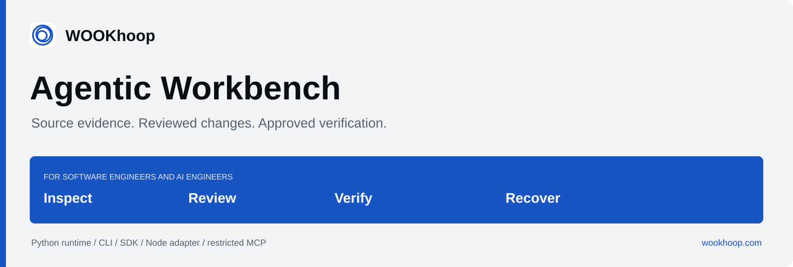
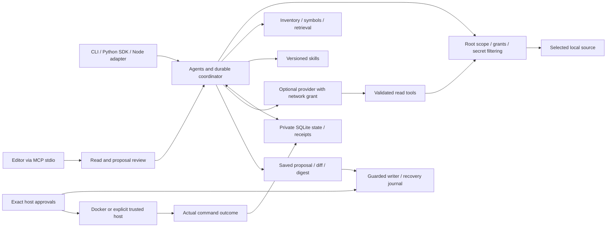

# WOOKhoop Agentic Workbench

**Understand the source. Review the change. Approve the command. Keep the evidence.**

A local framework for supervised AI-assisted development: source citations, versioned skills, durable tasks, exact human approvals and recoverable changes. The Python CLI and SDK own policy and execution; a typed Node adapter and a restricted MCP server use the same implementation.


[Get started](#install-from-a-reviewed-checkout) · [Repair a regression](#repair-a-regression) · [Architecture](#how-it-works) · [Integrations](#use-it-from-your-tools) · [Evidence and limits](#evidence-and-limits) · [Documentation](#documentation) · [Contribute](#contribute)

**Public developer preview.** Review the source before installation. Registry
packages and a stable release are not published. Start with the
[developer field guide](docs/public/GUIDE.md), the
[historical illustrated PDF guide](docs/public/WOOKhoop-Agentic-Workbench-Guide.pdf),
or the [current preview assessment](docs/public/PUBLIC-PREVIEW.md).
Hosted checks are visible in [GitHub Actions](https://github.com/ashutosh99sri-cyber/agentic-workbench/actions/workflows/ci.yml).

## Where it fits

Use Workbench when a development task needs a clear connection between the source you inspected, the change you approved and the check that actually ran.

| Your task | What Workbench provides |
| --- | --- |
| Understand an unfamiliar repository | Bounded inventory, source hashes and line citations, Python AST facts, lexical retrieval and optional TypeScript/JavaScript relationships. |
| Investigate a regression | Definitions, callers, imports, references and test locations; changed-path impact and context selection. |
| Review a proposed correction | Saved proposals with exact diffs, current base hashes, approval digests and guarded POSIX writes. |
| Repair a bounded Python defect | Approved failure reproduction, an explicit source-file allowlist, candidate review, approved verification and durable resume. |
| Build an internal coding assistant | A typed tool registry, trusted provider adapters, role routing, checkpoints, cancellation, budgets and effect receipts. |
| Recover after an interrupted change | Change journals and separately reviewed rollback that preserve later edits and ambiguous ownership. |

The core works offline. Optional OpenAI Responses and embeddings require a configured model, an external credential and an explicit network grant. Static analysis is labeled `static`; lexical, semantic and combined retrieval are identified separately. See [how this project's role compares with other tools](docs/public/COMPARISON.md).

## Install from a reviewed checkout

Requires **Python 3.11+**. Guarded source changes and command execution require POSIX. Python-only analysis does not require Node; the optional Node adapter requires **Node 24+**.

Clone the public source, inspect it, then install into an isolated environment:

```sh
git clone https://github.com/ashutosh99sri-cyber/agentic-workbench.git
cd agentic-workbench
python3 -m venv .venv-agentic
.venv-agentic/bin/python -m pip install .
. .venv-agentic/bin/activate
agentic --version
agentic --help
```

The distribution remains `agentic-workbench`, the Python import remains `agentic_workbench`, and the installed console scripts remain `agentic` and `agentic-workbench`. WOOKhoop is the presentation brand. The alternate console name is available if another tool already uses `agentic`.

On Windows, use the environment's `Scripts\python.exe` and `Scripts\agentic.exe`; restrict use to the [documented read-only subset](docs/support-matrix.md). Follow the [installation tutorial](docs/installation.md) for platform details and clean wheel installation.

## Start offline

Choose a project you control and replace the example source path with a real file in that project:

```sh
agentic init --root /absolute/path/to/application
agentic scan --root /absolute/path/to/application
agentic explain app.py --root /absolute/path/to/application --provider none
agentic plan "Investigate discount rounding and identify regression checks" \
  --root /absolute/path/to/application --provider none
agentic search "discount total" --root /absolute/path/to/application --provider none
agentic impact app.py --root /absolute/path/to/application
agentic skills --root /absolute/path/to/application
```

`init` creates private local state and configuration, preserving an existing valid configuration. Add `.agentic/` to the target application's `.gitignore`: it can contain source results, diffs and original rollback content. Protect state exports and backups as well.

Scan, explanation, planning and dry runs preserve application source; they can write application-owned state. No target dependencies are installed automatically. `scan` is an offline inventory command and does not accept `--provider`. Explicit `--provider none` on supported analysis commands overrides an existing project provider setting.

Ordinary CLI commands emit one version 1 JSON envelope, with `ok`, `data` or a structured `error`. `--json` is accepted explicitly. MCP uses its separate JSON-RPC stdio protocol.

<details>
<summary>Trace symbols, select context and add optional TypeScript structure</summary>

Every scan freshly reads the policy-bounded inventory. Unchanged derived facts can be reused, while source/configuration/redaction/ignore-rule/indexer changes invalidate reuse. The cache does not bypass source checks or treat timestamps as source identity.

Default local retrieval uses compact source windows and balances definitions,
callers and checks, including symbol-only questions. Agent context reserves early
byte capacity for those sources before filling detail. Resolved relationships keep
declaration identities; Python name ambiguity and missing structural coverage
remain explicit limits. See [context selection](docs/context-selection.md).

```sh
agentic context "Fix discount rounding" --changed-path app.py \
  --root /absolute/path/to/application
agentic explain discountedTotal --root /absolute/path/to/application \
  --provider none \
  --node-executable /absolute/path/to/node \
  --typescript-package /absolute/host-tools/node_modules/typescript
```

Native TypeScript/JavaScript analysis requires a separately installed, trusted **TypeScript 7.0.2** package and its matching native package. Supply both absolute host paths. The analyzer consumes closed source snapshots and ignores project compiler configuration/plugins. Dynamic behavior and unresolved external relationships remain explicit limits; the parser subprocess is trusted host code with time/input/output bounds, not an OS sandbox.

See [incremental indexing](docs/indexing.md), [TypeScript analysis](docs/typescript-analysis.md) and the [understanding evaluation](evaluations/understanding/README.md). Semantic and combined search use real provider embeddings with explicit network permission; they do not imply measured relevance or task-success gains.

</details>

## Repair a regression

The built-in repair workflow is deliberately bounded: **1–20 existing, indexed, writable non-test Python source files**, with **1–4 candidate attempts** and a default of two. It refuses test machinery, configuration, file creation, deletion and edits outside the host's allowlist.


1. Configure a named check and review its source snapshot. Approve the baseline command separately.
2. If the check reproduces a failure, a provider proposes a candidate for the allowed files.
3. Review the exact diff and digest, then approve that source change.
4. Review the command again for the changed snapshot, then approve verification.
5. A `repaired` result requires a reproduced failure, an applied approved change and a clean passing command whose snapshot still matches the source.

A baseline that already passes stops before a model request. An unusable startup, timeout or output-limit stop does not count as a reproduced defect. Unknown paid-provider outcomes stop for host review instead of automatic replay.

Configure the check in the target project's `.agentic/config.toml`. This example uses the Python image reference from the retained acceptance baseline; review its suitability and ensure that exact image is already present in your trusted local daemon:

```toml
[commands.unit]
argv = ["python", "-B", "-m", "unittest", "-q"]
image = "python@sha256:e88e9763f943ec1834f992a4b51e0f24500486803e8bc534e5767af9ea65f6ce"
timeout = 60
max_output_bytes = 1048576
```

The runner never pulls an image. The command must be meaningful for your project and must work with the dependencies already in the chosen image. A passing check establishes that check's outcome; it does not establish that every defect is fixed.

<details>
<summary>CLI repair: separate baseline, patch and verification approvals</summary>

Install the optional provider extra into the same environment, and set `OPENAI_API_KEY` privately in your host environment or secret manager. Keep credentials out of source, TOML, arguments and model instructions. `YOUR_MODEL` below is an operator-selected placeholder.

```sh
python -m pip install "/absolute/path/to/agentic-workbench[openai]"

agentic repair "Fix percentage discount rounding" \
  --root /absolute/path/to/application --command-id unit --edit-path app.py \
  --max-attempts 2 --provider openai --model YOUR_MODEL --allow-network
```

Inspect `data.reviews.baseline`. Repeat the same instruction and options with its task ID and exact baseline digest:

```sh
agentic repair "Fix percentage discount rounding" \
  --root /absolute/path/to/application --command-id unit --edit-path app.py \
  --max-attempts 2 --provider openai --model YOUR_MODEL --allow-network \
  --task-id TASK_ID --approve-baseline BASELINE_DIGEST
```

Inspect `data.reviews.change`, including the entire diff. Continue with its exact change digest:

```sh
agentic repair "Fix percentage discount rounding" \
  --root /absolute/path/to/application --command-id unit --edit-path app.py \
  --max-attempts 2 --provider openai --model YOUR_MODEL --allow-network \
  --task-id TASK_ID --approve CHANGE_DIGEST
```

Inspect `data.reviews.test`. Continue with the new command/snapshot digest:

```sh
agentic repair "Fix percentage discount rounding" \
  --root /absolute/path/to/application --command-id unit --edit-path app.py \
  --max-attempts 2 --provider openai --model YOUR_MODEL --allow-network \
  --task-id TASK_ID --approve-test TEST_DIGEST
```

Read the returned outcome and receipt. A failed check can produce another bounded candidate and another approval pause. Do not reuse a digest after source, command, configuration or skill drift. The last failed candidate stays applied for inspection; rollback is a separate reviewed action.

See the [complete repair lifecycle](docs/python-repair.md), [provider setup](docs/providers.md) and [recovery guide](docs/recovery.md). For a provider-free demonstration with a supplied candidate and disposable fixture, follow the [offline repair walkthrough](examples/offline_repair/README.md); it uses explicit trusted-host execution and does not measure model effectiveness.

</details>

<details>
<summary>Review an imported proposal, run a named check or roll back separately</summary>

These commands return reviews without changing source or executing the check:

```sh
agentic apply PROPOSAL_ID --root /absolute/path/to/application
agentic test --command-id unit --root /absolute/path/to/application
agentic apply --rollback CHANGE_ID --root /absolute/path/to/application
```

After inspecting the exact operation, repeat the relevant command with `--approve DIGEST`. Apply binds paths, expected base hashes, replacement content and effective configuration/skills. Test approval binds the command, snapshot, trusted executable, local daemon endpoint and image.

Docker is the default runner: no network, read-only root/source, non-root identity, resource limits and a disposable sanitized snapshot. `--trusted-host` selects a separate weaker backend with owner privileges and no OS sandbox; it is never an automatic fallback. Suspend conflicting editors/tools during writes: the POSIX lock is advisory, and multi-file recovery can be partial after a crash.

</details>

## How it works


<details>
<summary>Architecture as a GitHub Mermaid diagram</summary>



</details>

The experimental harness supplies typed host tools, capability-aware routing, token/cost reservations, source-bound decision memory and a checkpointed **Plan → Execute → Observe → Verify → Reflect** loop. `execute`, `trace`, `cancel`, `tools`, `skills` and `context` expose its lifecycle. Custom planners, executors and verifiers remain trusted host code. Read the [harness guide](docs/harness.md), [gap analysis](docs/harness-gap-analysis.md) and [implementation contract](docs/design/SPEC-harness.md).

## Use it from your tools

### Python SDK

```python
from agentic_workbench import Workbench

with Workbench("/absolute/path/to/application") as wb:
    inventory = wb.scan()
    explanation = wb.explain("app.py")
    plan = wb.plan("Investigate discount rounding")
    matches = wb.search("discount total")  # lexical; offline
```

This example assumes the project's provider is `none`, as created by `init`. Write, execute, trusted-host and network grants are explicit host capabilities. For a write, construct a trusted `Grant(write=True)`, inspect `wb.review(...)`, then call `wb.apply(..., approval=review["digest"], dry_run=False)`. Model instructions, source and skills cannot supply those grants or approvals. Run the [offline installed-SDK walkthrough](examples/sdk_walkthrough.py) to inspect source analysis, imported proposal planning and exact synthetic change approvals. See the [developer adoption guide](docs/developer-adoption.md) and [CLI/SDK reference](docs/api.md).

### Node adapter

The [private local Node package](adapters/node/README.md) wraps the installed CLI with typed methods, `shell: false`, bounded subprocesses, strict envelopes and typed errors. Build/package it locally as described in its guide; no public npm installation is assumed.

```typescript
import { Workbench } from "@agentic-workbench/node";

const workbench = new Workbench("/absolute/path/to/application", {
  executable: "/absolute/path/to/venv/bin/agentic",
});

const inventory = await workbench.scan();
const explanation = await workbench.explain("app.py");
```

It provides supported analysis, review, approval and harness bindings while Python retains policy authority. The built-in Python repair workflow is currently exposed through the CLI and Python SDK. Optional provider invocation requires explicit per-call options and credential forwarding; see the adapter's [API and environment contract](adapters/node/README.md).

### MCP and editors

```sh
agentic mcp --root /absolute/path/to/application --provider none
```

The stdio server exposes **scan, explain, search, impact, plan, run, status and review**. It has no approval, source mutation or test-execution tool. Results can contain source excerpts visible to the editor and its model. Provider/network access remains an explicit host choice.

The [editor recipes](docs/integrations/mcp-editors.md) cover Claude Code, VS Code and Cursor. Retained host evidence establishes only that **Claude Code 2.1.300 connected and listed tools**; successful task execution in that host, VS Code and Cursor remains unverified. The [provider adapter recipe](docs/integrations/provider-adapters.md) demonstrates trusted registration, budget admission, structured results and unknown-outcome handling with an injected transport.

<details>
<summary>Agent roles and model-visible capabilities</summary>

| Role | Implemented work |
| --- | --- |
| `discovery` | Inventory, framework/dependency evidence, file hashes and coverage. |
| `intelligence` | Cited explanation, Python definitions/calls and optional TypeScript/JavaScript relationships. |
| `engineering` | Affected-file plans; provider/imported candidates become reviewable proposals. |
| `architecture` | Source module/dependency boundaries and provider-assisted API, database and infrastructure review. |
| `ux` | Image-alt source checks and provider-assisted interface recommendations. |
| `testing` | Test source, configured commands and regression recommendations; execution is separately approved. |
| `documentation` | Source onboarding/API inventory and provider-assisted explanation. |
| `orchestrator` | Validated dependency graphs, durable specialist tasks and concurrency of at most two. |

`agentic run architecture "Review API boundaries" --root /absolute/path/to/application --provider none` invokes a role independently. `plan` coordinates discovery, applicable analysis, engineering and testing/documentation. The SDK supports explicit graphs of up to 32 nodes.

Six closed read tools are available to the built-in model flow: `repository_summary`, `read_source`, `search_code`, `lookup_memory`, `list_symbols` and `trace_symbol`. Trusted SDK extensions can register additional read capabilities under explicit scope. Tool visibility does not grant write/execute authority. Role names do not establish independently validated expert reasoning, and static UX checks do not render a browser.

</details>

## Evidence and limits

The latest verified development runtime is **`4a1f8c56239bb3b63bbf82b6bec543f72dc82222`**
(17 October 2026): **975 offline Python cases, 8 Docker cases, 3 unique
distribution cases checked against both wheel and source consumers, and 13 Node
tests passed**. All eight roles passed static and official OpenAI SDK mocked
transport checks. Changed-path retrieval recovered 8/8 tasks on the regression
set and 8/8 on a new independent holdout; query-only selections were identical
before and after on all 30 paired tasks. These are local source/workflow results,
not live model effectiveness or hosted CI. See the [public-preview assessment](docs/public/PUBLIC-PREVIEW.md),
[validation evidence](docs/validation.md), and [release readiness](docs/public/READINESS.md)
for limits and publication gates. Older implementation baselines remain historical evidence.

The public repository starts from a reviewed current-source snapshot. Earlier
development commits remain local; their hashes above identify historical
evidence rather than reachable public commits. The
[source provenance](docs/public/SOURCE-PROVENANCE.json) records the exact inherited
runtime file hashes. Runtime permissions and approval controls are unchanged.

The evaluation corpus includes 30 pinned historical Python defects from more-itertools, Click and packaging, with visible reproductions and separate holdout checks. No-patch and known-patch replay validate workflow/grading machinery. **Known-patch replay success is not LLM repair success.** Live model effectiveness, comparative task success, human-time savings and cost savings have not been established. See the [repair evaluation](docs/python-repair-evaluation.md).

<details>
<summary>Source disclosure, execution limits and ownership</summary>


- This is local owner-controlled software. It supplies no hosted-service authentication or tenant isolation. Trusted host code, installed dependencies and the OS owner remain trusted.
- Source excerpts can reach your selected provider or editor model. Known secrets and recognized patterns are redacted; unknown formats and business-sensitive information need host exclusions and context review.
- `.agentic/` can hold private results, diffs and rollback originals. Its local audit history is mutable by the OS owner.
- Request/token/deadline limits reduce exposure; they are not provider-enforced dollar caps. Unknown external outcomes require review.
- Docker leaves daemon/kernel/image trust with the host. Trusted-host execution has no OS sandbox. Guarded writes and runner execution are POSIX-only; Windows has a documented read-only subset.
- Static relationships can omit runtime dispatch and external behavior. Source inspection does not prove security, accessibility, scalability or model quality.

Read [security boundaries](docs/security.md), [source provenance](docs/design/SOURCE-PROVENANCE.md) and [support scope](docs/support-matrix.md). Report sensitive issues through the verified GitHub private vulnerability reporting channel in [SECURITY.md](SECURITY.md).

</details>

## Documentation

| Start here | Implementation and operations |
| --- | --- |
| [Developer field guide](docs/public/GUIDE.md) · [PDF edition](docs/public/WOOKhoop-Agentic-Workbench-Guide.pdf) | [CLI and SDK](docs/api.md) · [Architecture](docs/architecture.md) |
| [Installation](docs/installation.md) · [Developer adoption](docs/developer-adoption.md) · [Example projects](examples/README.md) | [Skills](docs/skills.md) · [Providers](docs/providers.md) |
| [Python repair](docs/python-repair.md) · [Offline walkthrough](examples/offline_repair/README.md) | [Harness](docs/harness.md) · [Recovery](docs/recovery.md) |
| [Indexing](docs/indexing.md) · [TypeScript analysis](docs/typescript-analysis.md) | [MCP/editor integration](docs/integrations/mcp-editors.md) · [Provider adapters](docs/integrations/provider-adapters.md) |
| [Fair comparison](docs/public/COMPARISON.md) · [Roadmap](docs/public/ROADMAP.md) | [Validation](docs/validation.md) · [Support matrix](docs/support-matrix.md) |
| [Readiness](docs/public/READINESS.md) · [Publication checklist](docs/public/PUBLICATION.md) | [Release process](docs/releasing.md) · [Maintainer responsibilities](MAINTAINERS.md) |

See [AI Hero research and runtime optimization](docs/aihero-review.md) for source-backed engineering choices, local before/after measurements and deferred technologies.

## Contribute

Start with [CONTRIBUTING.md](CONTRIBUTING.md), the [Code of Conduct](CODE_OF_CONDUCT.md) and [SUPPORT.md](SUPPORT.md). Keep changes bounded, distinguish source facts from runtime evidence and report the exact revision, versions and skips behind a result. Use the private reporting process for security-sensitive material.

From a reviewed checkout, contributor checks are:

```sh
uv sync --locked --all-extras
uv run --locked pytest -m "not docker and not distribution"
uv run --locked ruff check src tests scripts
uv run --locked ruff format --check src tests scripts
uv run --locked mypy src/agentic_workbench
uv build
cd adapters/node
npm ci --ignore-scripts
npm run build
npm test
```

Native parser, clean installed-consumer and actual Docker acceptance have separate prerequisites in the contribution/support guides. Node CLI integration requires `AGENTIC_EXECUTABLE` pointing to an absolute installed CLI. Ordinary CI does not invoke a paid provider. The [benchmark](scripts/benchmark.py) scores source targeting and named facts on the examples; live provider runs are separate explicitly authorized measurements. The example projects deliberately contain a discount regression and are fixtures, not business software.

## Licensing and release status

Authored code and bundled instructions are offered under [Apache-2.0](LICENSE), subject to the repository's [NOTICE](NOTICE), [third-party notices](THIRD_PARTY_NOTICES.md) and [source provenance](docs/design/SOURCE-PROVENANCE.md). The engineering skill's decision order is adapted from the MIT-licensed [Ponytail](https://github.com/DietrichGebert/ponytail). The owner confirmed distribution and WOOKhoop brand rights for this source preview. Branding does not change package identifiers or third-party rights.

**`v0.2.0` is a proposed future tag**, with a GitHub prerelease designation proposed for that release. It is not an existing tag or published version claim. A tagged or registry release still requires exact-commit hosted acceptance, registry ownership and explicit artifact approval. The source-preview approval does not approve future releases. Follow the [publication record and release procedure](docs/public/PUBLICATION.md) and [roadmap](docs/public/ROADMAP.md).
