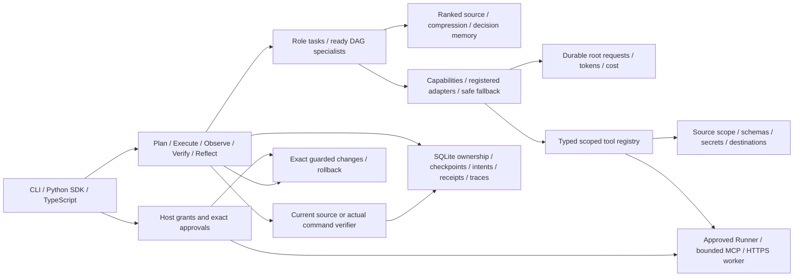

# Architecture and decisions

The [harness audit](harness-gap-analysis.md) records the verified starting point and the [harness guide](harness.md) documents the implemented extensions. The new execution controller sits above existing agents, exact proposals and the approved Runner. It checkpoints actual observations and requires a trusted verifier before completing an engineering execution. Existing `plan` remains an analysis workflow.

Tool/model extensions are trusted host registrations, with explicit versions/capabilities/resource contracts. Repository and skill content remain untrusted context. Unknown effects prevent replay; readiness scheduling does not broaden mutation privileges. Context freshness groups reads by source path, and vector caches reuse unchanged chunk text across index rebuilds. Callback deadlines are cooperative, while the existing Runner and new MCP/API transports enforce their own process deadlines. None of these components creates distributed or multi-tenant authorization.

The [README diagram](../README.md#architecture) describes data flow; the [capability map](design/CAPABILITY-MAP.md) defines dependency direction. Contracts/policy are foundational. Repository retrieval and skills remain independent of provider/state storage. Provider contracts inject tool, budget and receipt interfaces, preventing transport code from controlling execution state. Changes depend on guarded policy and local state. Agents coordinate those components; CLI, Python SDK and Node adapter expose them.

Python's standard library supplies argparse, AST, SQLite, hashes, concurrency and filesystem primitives. JSON Schema validates untrusted outputs. pathspec supplies ignore semantics. The optional official OpenAI SDK owns its documented API transport; locked transport fixtures cover the adapter's current SDK/httpx internals. No plugin module, project manifest or skill script is imported automatically.

The local SQLite store records exact pins, task transitions, child ownership, usage reservations, external intent/receipt pairs, retained context and change journals. This state is scoped to canonical root identity. Copying a database into another root does not confer access to its memory. WAL plus compare-and-set transactions support bounded specialist concurrency; this is not distributed scheduling or multi-user authorization.

Original skill content is immutable per task through metadata/content hashes. Selection combines role with observed frameworks/languages. A skill can request read tools, but host policy remains authoritative. Inference is labeled separately from facts. Provider code returns candidate changes as structured data; the change workflow validates current bases and stores an actual diff before any host-approved mutation.

Default provider bounds are eight root requests, six tool rounds, 16,000 complete payload bytes, 2,000 requested output tokens and a 60-second shared provider deadline. Child agents and embeddings share the request ledger. Explicit 429 rejections may retry at most twice inside those bounds. Unknown outcomes stop replay. Costs remain estimates unless an external provider enforces spending limits.

Source application has one POSIX advisory writer lock. Directory-relative no-follow operations, identity/content checks, staged replacements and fsync reduce alias/race risks. Multi-file changes use a journal; they are not a filesystem-atomic transaction. Other writers that ignore the advisory lock can still race the final check/rename window. Recovery preserves ambiguous ownership and subsequent user edits.

Tests run through a separate exact-approval boundary. Docker mounts only a sanitized temporary snapshot and cannot receive model-created commands. The weaker host backend is explicit. Windows can use portable source/state/interface paths; guarded mutation and runner locking require POSIX. Cross-platform CI expresses this distinction.

Static symbol tracing (2026-10-14). The index already held Python definitions and call expressions, but agents only surfaced symbol names from the top five lexical chunks. `RepositoryIndex.trace` now joins one symbol's definitions, call sites, callees and test-file lines, and both the `trace_symbol`/`list_symbols` read tools and the static intelligence, engineering and testing paths use it. Consequence: offline results name affected files and coverage gaps with evidence; dynamic dispatch remains unresolved. TypeScript/JavaScript relationships are now supported by the optional snapshot analyzer described below.

MCP surface (2026-10-14). Options were the official MCP SDK, a Node server in the adapter, or a standard-library JSON-RPC subset. The subset was chosen: it adds no dependency, exposes only read and review commands, and keeps approvals outside the model-visible schema. Consequence: prompts, resources and server notifications are not served; adopt the SDK if they are needed. One Workbench is created per tool call and closes afterward. MCP now shares one incremental derivation cache across these instances; every call still freshly reads the policy-bounded inventory.

Quality benchmark (2026-10-14). `scripts/benchmark.py` runs fixed tasks on the disposable examples and scores cited files, named symbols, test references, usage and latency, so static and provider output can be compared on identical inputs. It measures retrieval and plan targeting, not proposal correctness; approved-test outcomes remain the acceptance evidence for candidate edits.

Incremental source understanding (2026-10-15). The inventory walker is now `collect_workspace`, the per-file extractor is `index_source`, and `merge_source` preserves fresh inventory and traversal coverage. SDK scans and MCP reuse derivations keyed by workspace/configuration/indexer version plus path/raw hash/redacted-text hash/secret flag. Fresh content and ignore checks always precede reuse; deletions cannot retain old facts. One bounded mutable `index/derived` record supports reopen reuse, drops overflow with explicit counters and rebuilds corrupt rows. Chunks always use fresh source text. Request-local cache statistics do not alter source fingerprints or force index/current rewrites.

Optional native structure (2026-10-15). A trusted host selects an absolute Node executable and TypeScript 7.0.2 package directory. The bundled bridge receives only approved typed-language snapshots over stdin, with a closed virtual filesystem and synthetic compiler configuration. It returns bounded source-hash-cited declarations/imports/calls/references, with stable declaration IDs for aliases and re-exports. Unknown external, computed and dynamic behavior remains explicit. Any source/redaction/parser-pin change invalidates the cross-file graph; current relationship checks re-collect the inventory so new resolution files are also detected. Runtime files are rechecked before cached facts are reused. Native analysis has input/output/time limits; a V8 heap setting is not a hard native-process memory sandbox.

Selection and evidence (2026-10-15). Explicit changed paths guide bounded definition → caller/reference/check → lexical context selection. They grant no authority. Optional combined search uses deterministic reciprocal-rank fusion of lexical and validated real-vector rankings within the existing bounded candidate pool and provider budgets. The fixed [understanding evaluation](../evaluations/understanding/README.md) separates target-anchor retrieval, cache equivalence/latency, known-patch workflow controls and live-model effectiveness. Complete context coverage remains a measured limitation; no general autonomous task-success claim follows from structural links or cache reuse.

## Integration and release boundaries

[MCP/editor recipes](integrations/mcp-editors.md) use the existing read-only stdio
surface; host-visible source results and separate mutation/execution approvals are
explicit. [Provider recipes](integrations/provider-adapters.md) register trusted code
through ProviderRegistry and retain shared budget/intent handling without granting the
transport host tools. Fixed transport fixtures establish wiring, not model quality.

[Release evidence](releasing.md) binds clean immutable Git source, non-skipped actual
acceptance and distribution runtime bytes. Reusable CI tests the selected commit
before tagged packaging. Local receipts are operator-supplied evidence, not remote
attestation or owner approval. Public owner, security reporting, registry ownership
and required hosted checks remain operational gates outside this local runtime.
