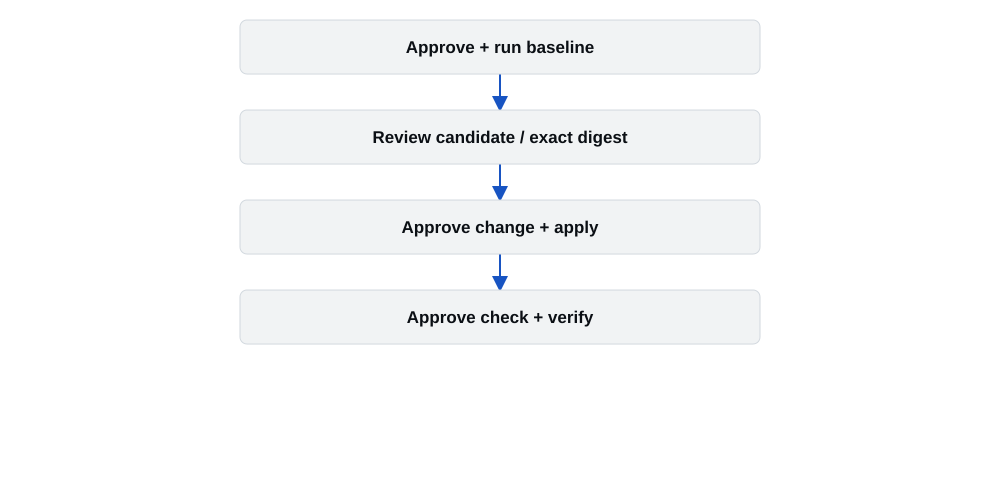
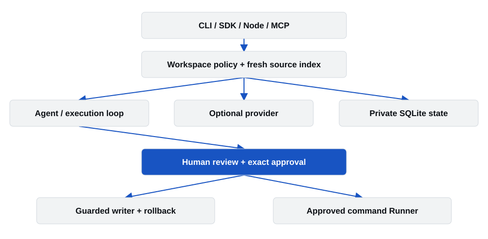
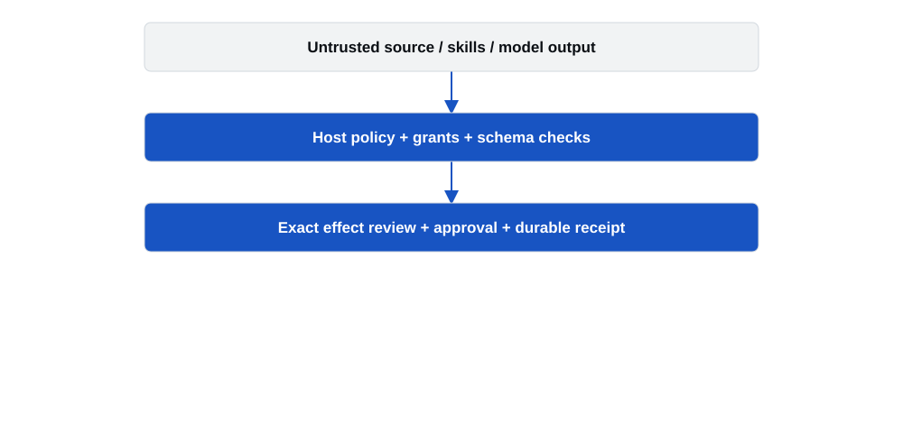

# WOOKhoop Agentic Workbench - Developer Field Guide

Historical edition: prepared before the public source preview. Use the
[current README](../../README.md), [preview assessment](PUBLIC-PREVIEW.md),
[maintainer records](../../MAINTAINERS.md) and [security policy](../../SECURITY.md)
for the current repository, reporting channels and validation scope. The PDF
edition retains this guide's original dated baseline.

Prepared 15 October 2026. Local alpha; publication gated.
Implementation baseline: 1e21f8a532ba7167dad26e8875a54ce487d03542.

## Engineering work with evidence

A WOOKhoop resource for software engineers, AI engineers and teams building controlled coding workflows.

WOOKhoop Agentic Workbench connects source investigation, reviewable changes, approved commands and recovery in one local Python framework. It is designed for repositories the operator controls. The CLI, Python SDK, TypeScript subprocess adapter and restricted MCP server share the same policy and state implementation.

The project vision is to make AI-assisted engineering work inspectable and repeatable: understand the source, reproduce a problem, review the exact proposed change, run an approved check and retain what happened. A provider can suggest a candidate; it cannot grant itself authority or declare runtime success.

### Use it where review and recovery matter

- Python maintainers investigating regressions and reviewing bounded fixes.
- AI engineers embedding tools, budgets, state and verification into developer products.
- Full-stack teams tracing TypeScript/JavaScript changes through imports, callers and tests.
- Startups standardizing AI-assisted maintenance without building a second execution policy.

Release posture: local alpha candidate. Public hosting, live-model effectiveness, maintainer identities and operational reporting are separate acceptance gates. This guide is documentation, not release approval.


## What the implementation delivers

Implemented surfaces, with the boundary beside the capability.

| Capability | Implemented behavior |
| --- | --- |
| Source understanding | Inventory, source hashes/citations, Python AST facts, lexical search and optional native TypeScript/JavaScript relationships. |
| Controlled changes | Saved proposals, exact diff/digest review, host grants, guarded POSIX writes, journals and reviewed rollback. |
| Repair | Named failure reproduction, bounded Python source candidates, separate apply/check approvals and durable resume. |
| Harness | Typed tools, host planners/executors/verifiers, checkpoints, cancellation, budgets, receipts and dependency plans. |
| Model access | Built-in optional OpenAI Responses/embeddings; explicit trusted provider registration and routing extensions. |
| Integration | Python CLI/SDK, typed Node subprocess adapter, eight read/review MCP tools and editor recipes. |

The core works without a provider. Static inventory and source-contract analysis are useful offline. Candidate generation with a model requires a configured provider, credential and explicit network grant. Imported or fixture candidates are separate paths.

Role names do not establish eight independently validated expert reasoning systems. Static UX checks inspect source patterns; they do not render a browser or certify accessibility.


## Choose a task that fits

The strongest current fit is supervised repository work with a clear acceptance check.

| Audience | Daily application | Boundary |
| --- | --- | --- |
| SWE / backend | Trace a failing function; review an approved Python correction. | Selected check quality determines what is verified. |
| AI engineer | Build tool and provider adapters with durable effects and host-owned policy. | Injected callbacks are trusted host code. |
| Full-stack developer | Inspect aliases, imports, references and affected test locations. | Dynamic runtime dispatch and external packages can remain unresolved. |
| Startup / team | Standardize review, trace, command execution and recovery. | No shared-service authentication or tenant isolation is supplied. |
| Infrastructure developer | Inspect configuration source and wire approved repository checks. | Cloud deployment, account access and drift reconciliation are not built-in. |

### A good first task

Choose a small Python service, an existing failing unit check and a short source-file allowlist. Define the expected behavior before asking for a candidate. Keep credentials out of source and use disposable examples for the first approval workflow.

### A task needing custom host engineering

A broad migration involving new files, renames, test/configuration changes and several packages exceeds the built-in repair path. The custom harness can support staged work, but the host must supply its plan, effect and verification logic.


## Four practical developer routines

Examples describe supported workflows, not measured time savings.

### 1. Understand an unfamiliar module

Scan the repository, explain a symbol, inspect its source citations and review callers/imports/test mentions. Read the cited lines before deciding whether the static relationship matches runtime behavior.

### 2. Investigate a regression

Reproduce a failing configured command, allow the repair workflow to request a bounded candidate, inspect the exact diff, approve the change and approve the new source snapshot for verification. Preserve task and change IDs.

### 3. Plan a cross-file change

Supply changed paths to impact/context. Use definitions, callers, imports, references and linked tests to prepare a review checklist. Impact selections guide reading; they do not authorize writes or prove executed test coverage.

### 4. Build an internal coding assistant

Register trusted tools/providers, define grants and budgets, persist task state and use a verifier tied to an actual acceptance condition. Expose the read-only MCP surface to an existing editor while keeping mutation/execution approvals outside the model.

Potential savings are fewer repeated evidence-gathering and recovery chores. Human-time reduction, cost savings and comparative task-success rates have not yet been measured.


## Install from a reviewed checkout

There is no verified public PyPI or npm publication to install by name.

Requirements: Python 3.11 or later. Guarded writes and runner execution require POSIX. The Node adapter requires Node 24 or later. Docker acceptance needs a trusted local daemon and an already-present approved digest image. Python-only analysis does not require Node.

```
cd /path/to/agentic-workbench
python3 -m venv .venv-agentic
.venv-agentic/bin/python -m pip install .
.venv-agentic/bin/agentic --version
.venv-agentic/bin/agentic --help
. .venv-agentic/bin/activate
```

On Windows, create the venv with py -3 and use .venv-agentic\Scripts\python.exe and agentic.exe. Limit use to the declared read-only subset. Do not infer Windows mutation or execution support from a successful installation.

### Install for development

```
uv sync --locked --all-extras
uv run --locked pytest -m "not docker and not distribution"
uv run --locked ruff check src tests scripts
uv run --locked mypy src/agentic_workbench
```

WOOKhoop is the presentation brand. The distribution remains agentic-workbench, the Python import remains agentic_workbench, and the console scripts remain agentic and agentic-workbench.


## Start offline in a target project

Use an absolute path to the installed executable and a project you control.

```
agentic init --root /path/to/application
agentic scan --root /path/to/application
agentic explain app.py --root /path/to/application --provider none
agentic plan "Investigate discount rounding" \
  --root /path/to/application --provider none
agentic impact app.py --root /path/to/application
```

init creates application-owned configuration and private state, preserving an existing valid configuration. Add .agentic/ to the application .gitignore. Scan/explain/plan inspect source and can create local state; they do not modify application source.

### Read the response contract

```
{"schema_version": 1, "ok": true, "data": {...}}
```

The object above illustrates the envelope shape; the ellipsis is not literal JSON output. Successful ordinary CLI commands emit one versioned envelope. Errors use ok:false and a structured error. MCP is a separate JSON-RPC stdio protocol.

Source hashes and line citations identify what was observed. They do not prove that a recommended change is correct or that tests have run.


## Make authority an explicit choice

Configuration describes behavior; the trusted host supplies capabilities.

```
[provider]
name = "none"

[commands.unit]
argv = ["python", "-B", "-m", "unittest", "-q"]
timeout = 60
max_output_bytes = 1048576
```

The fragment illustrates a named argv-array command for explicit trusted-host execution. Docker commands additionally need a suitable approved image digest. Choose an image with the required runtime already available; the Runner never pulls an image.

- Write, execute, trusted-host and network grants are distinct.
- A source proposal or project instruction cannot create a grant.
- Approval identifies an exact operation and source snapshot; review it again after relevant drift.
- Provider credentials are resolved from a configured environment reference or a trusted host resolver. Do not put credentials in TOML or command arguments.

### Optional provider setup

```
python -m pip install ".[openai]"
# Set OPENAI_API_KEY privately in your shell or secret manager.
agentic run engineering "Review rounding" --root /path/to/app \
  --provider openai --model YOUR_MODEL --allow-network
```

YOUR_MODEL is a required operator-selected placeholder, not a verified model ID. Review destination/source disclosure and spending before any live call. Local reservations are not a provider-enforced dollar cap.


## Reproduce, review, apply, verify

A repaired outcome requires an actual approved command result.



The built-in Python repair workflow admits 1-20 existing, indexed, writable non-test Python source files and 1-4 attempts (two by default). It refuses test machinery, configuration, new files, deletions and paths outside the host allowlist.

The workflow pauses separately for baseline command approval, candidate change approval and verification approval. Resume with the returned task ID and the current exact digest. A passing baseline reports already_passing before a model request. An unusable startup, timeout or output overflow stops rather than pretending to reproduce a defect.

A selected command can be inadequate. Define targeted behavior checks and broader regression/type/build checks in an explicit acceptance command when the task needs them. Passing that command is narrower than proving all requested behavior.


## Try a complete disposable exercise

No provider credential or network grant is needed for the supplied-candidate walkthrough.

```
python -B examples/offline_repair/walkthrough.py --trusted-host
```

The script prints a new retained temporary workspace and copies the deliberately broken Python discount example. Read each displayed review and digest before entering the separate approval word.

| Prompt | What approval permits |
| --- | --- |
| BASELINE | Run the displayed failing Python command on the reviewed snapshot. |
| APPLY | Apply the displayed supplied correction at the exact reviewed digest. |
| CHECK | Run the displayed verification command on the repaired snapshot. |
| ROLLBACK | Restore eligible original fixture content after a separate review. |

The script closes and reopens Workbench at approval boundaries. Declining or interrupting preserves its workspace and prints available references. It has no automatic approval option. Existing destinations are refused. The checked-in example is preserved.

```
agentic status TASK_ID --root WORKSPACE_PATH
agentic trace TASK_ID --root WORKSPACE_PATH
```

This known fixture uses the explicitly weaker trusted-host backend. A supplied correction proves wiring, verification and recovery; it is not evidence that a live model discovered the fix. After rollback, the current fixture is deliberately buggy again.


## Embed the same runtime

Use the public Workbench API and keep effect authority in host code.

```
from agentic_workbench import Workbench

with Workbench("/absolute/path/to/application") as wb:
    inventory = wb.scan()
    explanation = wb.explain("src/app.py")
    matches = wb.search("invoice total")
    impact = wb.impact(["src/app.py"])
```

The context manager closes the local state store. Analysis defaults can remain provider-free. To perform effects, trusted host code constructs explicit Grant values, requests review, displays the returned diff/command and supplies the exact approval for that operation.

### Custom execution

The harness accepts typed planner, executor and verifier callbacks. It records Plan / Execute / Observe / Verify / Reflect phases, attempts, dependencies, failure signatures and checkpoints. The host decides what verification means. Source-contract analysis and an actual passing command are separate evidence scopes.

### Custom provider

Copy the documented CallbackProvider recipe into trusted host code and register it explicitly. It receives bounded JSON, a monotonic deadline and a response cap; no executor or credentials are supplied to transport. Unknown outcomes block automatic replay.

Callbacks execute as trusted host Python. A cooperative deadline cannot forcibly stop an arbitrary blocking callback. Do not expose this SDK as an untrusted multi-tenant service without a separate isolation design.


## Connect an existing coding assistant

Eight read/review tools; no model-facing apply or test execution.

```
agentic mcp --root /absolute/path/to/application --provider none
```

| MCP tool | Purpose |
| --- | --- |
| scan / explain | Source inventory and source-grounded explanation. |
| search / impact | Lexical chunks and static changed-file relationships. |
| plan / run | Planning and role analysis under existing policy/provider choices. |
| status / review | Retained task state and proposal review. |

Use the supplied Claude Code, VS Code or Cursor config template and replace the absolute executable and root paths. Approve project-server configuration in the host as required. --provider none explicitly overrides an existing project provider setting.

Tool results can contain source excerpts visible to the editor and its model. Read-only source access is still source disclosure. Do not register a sensitive repository without reviewing that host and its model settings.

Verified host evidence: installed Claude Code 2.1.300 connected and listed tools with throwaway configuration and denied outbound IP traffic. It did not invoke a tool. Cited search and denied apply were tested separately over real stdio. VS Code/Cursor host behavior remains unverified.


## One policy and execution boundary

CLI, SDK and adapters converge on the same Python implementation.



Inputs pass through workspace policy, source collection, indexing and context selection. Static agents or an optional provider produce source-grounded results and saved proposals. Host approvals bind the exact change or command before the writer or Runner crosses an effect boundary.

SQLite holds task state, intents/receipts, checkpoints, memory and change journals. The state store is local owner-controlled history, not a tamper-proof audit service. External provider access is opt-in; source text and model output cannot authorize effects.

There is no inspected HTTP server, distributed scheduler, authenticated remote tenant boundary or hosted control plane. Those are separate products and operational responsibilities.


## Responsibilities and dependencies

Small core dependencies, with optional integrations kept explicit.

| Component | Responsibility |
| --- | --- |
| policy / secrets | Root/path confinement, protected files, grants and conservative redaction. |
| repository / cache / impact | Fresh source, AST facts, bounded derived-fact reuse, citations and impact. |
| context / retrieval | Source-bound selection, decisions and optional vector/combined retrieval. |
| providers / routing | Provider contracts, host registration, known-rejection fallback and reservations. |
| tools / execution / state | Typed tools, approval/idempotency, durable loops, tasks and receipts. |
| changes / writer / runner | Proposal reviews, guarded mutation/recovery and approved commands. |

Core runtime dependencies: jsonschema and pathspec. Standard-library SQLite stores state. The optional OpenAI extra pins openai and httpx2. Node interop builds with the locked TypeScript toolchain; optional structural analysis requires explicit trusted Node and TypeScript 7.0.2 paths.

Dependency licenses differ. pathspec is MPL-2.0; merely declaring it does not relicense the entire project. Distributing environments, executable bundles or container images needs a separate complete dependency notice/source review.


## Fresh evidence across repeated work

Caching saves derivation work; it does not skip source security checks.

- Every refresh walks and freshly reads policy-admitted source, hashes raw bytes and applies current exclusions/redaction.
- Reusable per-file facts bind raw hash, redacted content, secret flag, workspace, config and analysis version.
- Chunks come from fresh reads. Corrupt or invalid durable facts are rebuilt.
- Impact traces definitions, callers, imports, references and linked tests; changed paths guide context, not authority.

### TypeScript/JavaScript

The optional pinned native parser handles declaration relationships including aliases, re-exports and shadowing using supplied snapshots and a closed virtual filesystem. It does not load application plugins/config or execute the application. Dynamic or external relationships may stay unresolved.

### Measured limitation

In six frozen context-selection tasks, lexical retrieved 5/22 exact anchors and impact 8/22. Both covered all required anchors in 0/6 tasks. Impact received predeclared changed paths, so this is not an equal-information model comparison. Vector/combined modes were unavailable without a real embedding provider.

Every refresh still reads admitted files; TypeScript analysis is fresh and bounded. No general monorepo-scale, retrieval-quality or end-to-end repair speedup claim follows from the cache design.


## Choose the tool for the job

A source-based positioning comparison, not a performance ranking.

| Tool | Primary fit | Relation to this project |
| --- | --- | --- |
| OpenAI Agents SDK | General agent turns, tools, handoffs, guardrails and tracing. | Use for broader agent applications; compare extension needs rather than assume feature exclusivity. |
| LangGraph | Custom stateful graphs, durable execution and human oversight. | A broader graph runtime for hosts implementing their own workflows. |
| OpenHands SDK | Code-focused agents with execution/editing tools and local/remote workspace options. | A close coding-agent integration/comparison target for controlled experiments. |
| Aider | Terminal pair programming with Git-aware changes. | Useful for direct interactive coding; this project emphasizes reusable approval/evidence workflows. |
| WOOKhoop Workbench | Local source evidence, approved effects, verification and recovery through shared Python policy. | Useful for supervised engineering and embedding a controlled execution layer. |

Comparisons are based on official documentation accessed 15 October 2026. No head-to-head task benchmark was run. Frameworks can overlap and integrate; none of these rows establishes superiority.

References: OpenAI Agents SDK docs; LangGraph overview; OpenHands Software Agent SDK; Aider Git integration. Exact URLs are listed in the source register.


## Treat data and authority separately

The host owns capabilities; the model supplies untrusted proposals.



- Keep .agentic/ private and out of Git: it can contain task history and original rollback source.
- Review source exclusions and the destination host/model before sending code. Redaction is conservative, not a complete classifier of sensitive information.
- Use Docker for supported approved project commands; trust the daemon, kernel and image. Trusted-host mode has no OS sandbox.
- Do not retry uncertain external effects automatically. Inspect retained intent/receipt state.
- Suspend conflicting writers during apply; advisory locks require cooperation.

The static review found no confirmed vulnerability in reviewed core paths. Overall semantic coverage is partial, not a security certification. Do not publish credentials, exploit details or private traces in public issues.


## Open source with clear obligations

Recommendation: retain the existing Apache-2.0 project license.

| License | Commercial reuse | Key obligation / tradeoff |
| --- | --- | --- |
| MIT | Permissive; proprietary reuse allowed. | Retain copyright/permission notice; short terms, no express patent grant in the standard text. |
| Apache-2.0 | Permissive; proprietary reuse allowed. | Express contributor patent license; preserve applicable notices and modified-file notices; no trademark grant. |
| GPLv3 | Commercial use allowed. | Strong copyleft on conveyed covered works; corresponding-source and license obligations depend on distribution facts. |

Apache-2.0 matches current Python/Node metadata and supports broad commercial adoption. This recommendation does not establish ownership. The owner must confirm employment/customer/contributor rights and the legal identity entitled to license original work.

Retain conservative MIT notices for the Ponytail-adapted engineering skill and the small more-itertools evaluation snippet. Upstream evaluation archives keep their own licenses; do not redistribute them without the recorded notices. Brand names and logos do not gain blanket trademark permission from the code license.

This is an engineering licensing review, not legal clearance. Dependencies may have their own licenses; three conditional locked Python dependencies were unavailable locally for license verification. Consult qualified counsel when ownership or distribution obligations are unclear.


## Separate safety from effectiveness

The latest implementation acceptance is strong; live coding quality remains unmeasured.

| Retained acceptance | Observed result |
| --- | --- |
| Offline Python suite | 869 passed; 9 Docker/distribution tests excluded from that selection; zero selected skips. |
| Actual Docker | 7 Node confinement/cleanup cases and 1 Python unusable-baseline case passed. |
| Installed consumers | Clean wheel Python 3.11 and sdist Python 3.12 checks, approved repair and understanding smokes passed. |
| Node adapter | Build, 12 protocol tests, 1 installed CLI test and example type check passed. |
| Historical corpus | Known supplied patches verified 28/30 selected defects; two setup blocks retained. |
| Live/provider quality | No live repair or embedding effectiveness established; review-time savings unmeasured. |

The 869-test result is retained acceptance for implementation commit 1e21f8a53 before this documentation package. It is not a new run on the branding changes. Final documentation/package checks must be recorded separately for the release candidate.

A replayed known patch validates control and grading machinery. It is not a model success rate. Any future comparison should retain failed/blocked tasks and use independent behavioral checks.


## Recover without weakening a guard

Use the typed error, task ID and exact command/source receipt.

| Symptom | Action |
| --- | --- |
| Package cannot import | Verify the intended interpreter and installed distribution; test a fresh venv outside the checkout before changing source. |
| Docker unavailable | Start the local engine; verify trusted local socket and already-present image digest. Never switch to trusted-host silently. |
| Approval rejected / conflict | Re-read the current diff or command review. Source/configuration/skills may have changed; use a fresh exact digest. |
| OUTCOME_UNKNOWN | Inspect durable intent and receipt state. Do not automatically repeat a potentially paid/effectful operation. |
| Native TypeScript unavailable | Supply both trusted absolute Node/package paths with the pinned version; otherwise use Python/lexical analysis. |
| No valid repair candidate | Inspect context/output limits and evidence. Large full-file replacements can exceed bounds; record the failure. |

### Useful diagnostic commands

```
agentic --version
agentic status TASK_ID --root /path/to/application
agentic trace TASK_ID --root /path/to/application
agentic tools --root /path/to/application
agentic skills --root /path/to/application
```

Do not share raw .agentic state or command traces publicly. Replace sensitive source and credentials with a minimal synthetic reproduction.


## Questions teams ask first

Practical answers without autonomy or deployment assumptions.

### Does it work without a model?

Yes for inventory, source-grounded static analysis and lexical/context operations. The supplied-candidate exercise is offline. A live model is needed to evaluate live model-generated repair quality.

### Can it repair TypeScript or change tests automatically?

The packaged repair workflow is for existing non-test Python files. TypeScript/JavaScript structural analysis is available; broader editing workflows need explicit host implementation and verification.

### Is it ready for autonomous production work?

It is a local owner-controlled framework suitable for bounded supervised pilots. Broad unattended tasks, multi-tenant hosting, cloud deployment and security certification are not established.

### Are there hard spending guarantees?

Local request/token/cost reservations constrain admission using supplied information. They are not provider-enforced monetary ceilings, and missing usage/pricing remains unknown.

### Does MCP give my editor permission to change files?

The supplied server exposes read/review tools, not apply/test/execute. Tool results may disclose source to the host/model. Separate host actions grant and approve changes.

### Can I publish it now?

Not on the strength of this guide. Complete the owner/IP, security reporting, exact-source hosted acceptance and artifact review gates, then obtain explicit approval to make the named repository public.


## Prove the next useful capability

Priorities are proposals, not implemented promises or delivery dates.

| Priority | Next work | Evidence to require |
| --- | --- | --- |
| 1 | Run live representative repair trials and unfamiliar-developer pilots. | Correct fixes, regressions, review minutes, tokens, latency and cost per accepted fix. |
| 2 | Improve complete task context and evaluate real embeddings. | Held-out anchor coverage plus better downstream task results under controlled inputs. |
| 3 | Strengthen explicit acceptance sets. | Targeted/broader regression, type/build checks bound to the same final snapshot. |
| 4 | Ship one staged cross-file workflow. | Real migration/refactor tasks with interruption/resume and reviewed file/test changes. |
| 5 | Improve localized edits and large-repo behavior. | Conflict correctness, bounded context/output, representative memory and p50/p95 latency. |
| 6 | Complete public operations and onboarding. | Exact-commit hosted CI, real reporting/maintainer endpoints, package ownership and repeat users. |

The next development cycle should measure task outcomes before adding broad autonomy. Prefer one finished workflow with retained failure evidence over a large catalogue of roles. Track weekly repeat use and accepted changes alongside installation counts.

Do not publish unverified performance percentages or claim superiority over established tools. Fix capability gaps that real task evidence identifies.


## Make contributions reviewable

A public community starts with reproducible work and real ownership.

- Read CONTRIBUTING.md, SECURITY.md, CODE_OF_CONDUCT.md and the support matrix.
- Choose a bounded issue and state expected behavior before changing implementation.
- Use locked dependencies, synthetic fixtures and behavior-focused regression checks.
- Preserve existing user changes; keep source/effect policy and approval semantics explicit.
- Document changed public behavior, limitations, migrations and actual verification.
- Retain third-party license/notice provenance and confirm rights to submitted work.

### Publication checklist

Confirm the legal owner and intended public history; establish maintainers and private reporting; create/select the destination only when authorized; run hosted checks on exact source; review distributions/notices/hashes; approve a plain semantic version and exact artifacts; obtain explicit public-visibility approval.

### Version strategy

The selected first version is v0.1.0 with the GitHub prerelease flag until broader acceptance is complete. Registry upload remains pending authentication and namespace ownership; see the [current release notes](../releases/0.1.0.md). Current release scripts accept plain X.Y.Z. Use v1.0.0 only after public interfaces and support expectations are stable.

No GitHub repository URL, maintainer email, public registry release or response-time guarantee is invented. WOOKhoop.com is the verified brand website, not an established vulnerability-reporting endpoint.


## Source and evidence register

Technical facts come from the repository; external comparisons and licensing use primary sources.

| Topic | Source |
| --- | --- |
| Implementation baseline | Commit 1e21f8a532ba7167dad26e8875a54ce487d03542; retained recommendations 9-10 acceptance. |
| Runtime guides | docs/harness.md; docs/python-repair.md; docs/indexing.md; docs/typescript-analysis.md; docs/security.md. |
| Integrations / release | docs/integrations/mcp-editors.md; provider-adapters.md; docs/releasing.md; docs/support-matrix.md. |
| Brand | https://www.wookhoop.com/ and its published icon/CSS, observed 15 October 2026. |
| MIT / Apache / GPL | opensource.org/license/mit; apache.org/licenses/LICENSE-2.0; gnu.org/licenses/gpl.en.html. |
| Tool positioning | openai.github.io/openai-agents-python/; docs.langchain.com/oss/python/langgraph/overview; docs.openhands.dev/sdk; aider.chat/docs/git.html. |
| Security operations | docs.github.com/en/code-security/how-tos/report-and-fix-vulnerabilities/configure-vulnerability-reporting/configure-for-a-repository. |

The public documentation package includes readable Markdown, Mermaid diagram sources, SVG diagrams and this PDF. The private release-assessment bundle retains history/privacy review and detailed commands; do not upload private local state or unrelated output folders.

Prepared 15 October 2026. Facts, dependency advisories and external product documentation can change. Revalidate the exact selected source and artifacts before release.
